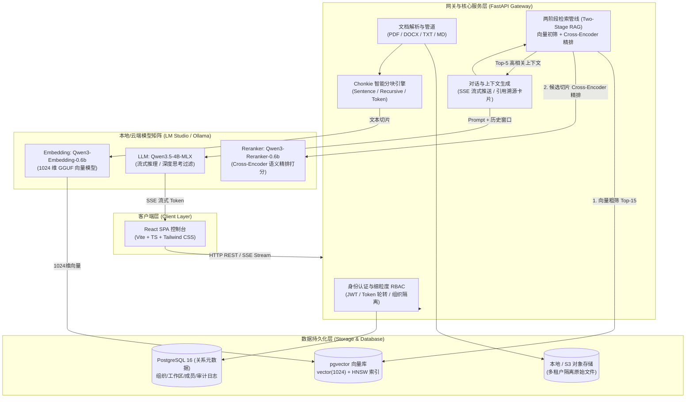

# AI Knowledge Hub (企业级 AI 知识库与 RAG 问答系统)

[](LICENSE)
[](https://www.python.org/)
[](https://fastapi.tiangolo.com/)
[](https://react.dev/)
[](https://github.com/pgvector/pgvector)
[](https://astral.sh/uv)

[English](#english) | [中文](#中文)

---

<a name="中文"></a>
## 📖 项目简介

**AI Knowledge Hub** 是一套现代化、支持多租户隔离的企业级 AI 知识库与两阶段检索增强生成 (Two-Stage RAG) 问答系统。

系统支持多种格式文档上传、**Chonkie 结构化智能自适应切片**、向量化嵌入、基于 pgvector 的高维相似度候选召回，以及 **Cross-Encoder 重排精排 (Reranker)**，并深度适配本地高性能模型矩阵（LM Studio / Bionic / Ollama：`text-embedding-qwen3-embedding-0.6b` (1024 维)、`qwen3-reranker-0.6b`、`qwen3.5-4b-mlx`）及主流云端大模型，为企业提供高效、可溯源、权限可控的智能知识中台。

### 🌟 核心特性

- 🏢 **多租户与组织隔离**: 采用 `Organization` -> `Workspace` 两级架构与细粒度 RBAC，确保各组织数据与问答在物理及逻辑层完全隔离。
- 📑 **Chonkie 结构化自适应分块**: 集成轻量高性能分块框架 Chonkie，支持 `sentence`（句子语义边界）、`recursive`（递归层级）、`token`（固定窗口）策略，完整保留文档页码及字符偏移元数据。
- 🔍 **两阶段检索管线 (Two-Stage Retrieval)**:
  - **初筛 (Retrieval)**：基于 PostgreSQL `pgvector` HNSW 索引快速召回高维向量候选集（Top 15）。
  - **精排 (Rerank)**：接入专用重排模型（如 `qwen3-reranker-0.6b`），以 Cross-Encoder 语义打分重排取最终上下文（Top 5），显著提升长尾与技术文档召回准度。
- 🤖 **本地与云端模型无缝适配**:
  - **Embedding 向量化**: 适配 1024 维度的 Qwen3 GGUF 向量模型（如 `text-embedding-qwen3-embedding-0.6b`）及 OpenAI 兼容接口。
  - **Reranker 精排**: 兼容标准 `/v1/rerank` 端点与原生 ChatML 提示词打分（内置内存自适应与长度防御）。
  - **LLM 生成**: 适配各类 OpenAI 兼容端点（如 LM Studio 本地部署的 `qwen3.5-4b-mlx`，支持思考推理标签过滤与平滑流式推送）。
- 💬 **会话与智能问答 (RAG)**: 上下文感知多轮对话，动态引用溯源卡片（包含文档来源、分块页码与精排打分 `rerank_score`）。
- 🛡️ **安全审计追踪 (Audit Trail)**: 针对登录、文档上传、知识库检索、权限变更等全生命周期记录不可篡改的审计日志。
- 🎨 **现代化全栈体验**:
  - **后端**: Python 3.11+ / 3.12 + FastAPI + SQLAlchemy 2.0 (Async) + Pydantic v2 + uv
  - **前端**: React + Vite + TypeScript + Tailwind CSS + Lucide Icons + 响应式双令牌静默轮转

---

## 🏗️ 架构概览



---

## 🚀 快速启动

### 1. 启动基础设施与向量数据库

```bash
# 启动 PostgreSQL 16 (内置 pgvector 扩展)
docker compose up -d postgres
```

### 2. 准备本地模型（以 LM Studio / Bionic 为例）

启动本地模型运行时（端口 `1235`），并加载以下模型：
1. **Embedding**: `text-embedding-qwen3-embedding-0.6b` (GGUF, 1024 维)
2. **Reranker**: `qwen3-reranker-0.6b`
3. **LLM**: `qwen3.5-4b-mlx` (或其它开源兼容模型)

### 3. 后端服务启动

推荐使用现代 Python 包管理器 **uv**：

```bash
# 复制环境变量配置
cp .env.example .env

# 同步安装所有后端依赖（包含 chonkie、fastapi、sqlalchemy 等）
uv sync

# 执行数据库迁移
uv run alembic upgrade head

# 启动 FastAPI 服务
uv run uvicorn backend.app.main:app --host 0.0.0.0 --port 8000 --reload
```

后端 API 文档将在 `http://localhost:8000/docs` 提供。

### 4. 前端应用启动

```bash
cd frontend

# 安装依赖
npm install

# 启动开发服务器
npm run dev
```

前端界面将在 `http://localhost:5173` 运行。

---

## 🧪 自动化测试与质量保障

后端包含 170 项完整自动化测试，覆盖多租户边界、文档解析切片、pgvector 向量库检索、Rerank 打分、审计日志等核心场景：

```bash
# 执行全部单元与集成测试
uv run pytest

# 前端静态检查与生产构建
cd frontend && npm run build
```

---

<a name="english"></a>
## 📖 English Overview

**AI Knowledge Hub** is a production-grade, enterprise AI Knowledge Base and Two-Stage Retrieval-Augmented Generation (RAG) platform built with a multi-tenant architecture.

### ✨ Key Features

- 🏢 **Multi-Tenancy**: Strict `Organization` and `Workspace` two-level data isolation with granular RBAC.
- 📑 **Chonkie Adaptive Chunking**: Structure-aware document chunking supporting sentence, recursive, and token strategies with precise page & character span preservation.
- 🔍 **Two-Stage RAG Pipeline**: High-dimensional vector candidate retrieval via `pgvector` HNSW index followed by Cross-Encoder neural reranking (e.g. `qwen3-reranker-0.6b`).
- 🤖 **Model Matrix Compatibility**: Built-in support for 1024-dimensional Qwen embeddings, Qwen Rerankers, and local OpenAI-compatible inference backends (LM Studio, Ollama, vLLM).
- 💬 **Context-Aware Streaming Chat**: Multi-turn dialogue with citation cards displaying document origin and rerank relevance scores.
- 🛡️ **Enterprise Audit Trail**: Full-lifecycle audit logging for compliance and tracking.
- ⚡ **Modern Full-Stack**: Python 3.11+ / FastAPI, SQLAlchemy 2.0 Async, PostgreSQL pgvector, React, TypeScript, Tailwind CSS, packaged with `uv`.

---

## 📄 开源许可 / License

本项目采用 [MIT License](LICENSE) 许可协议。
