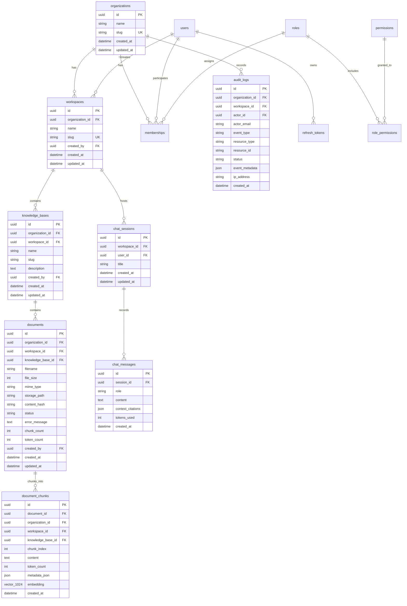
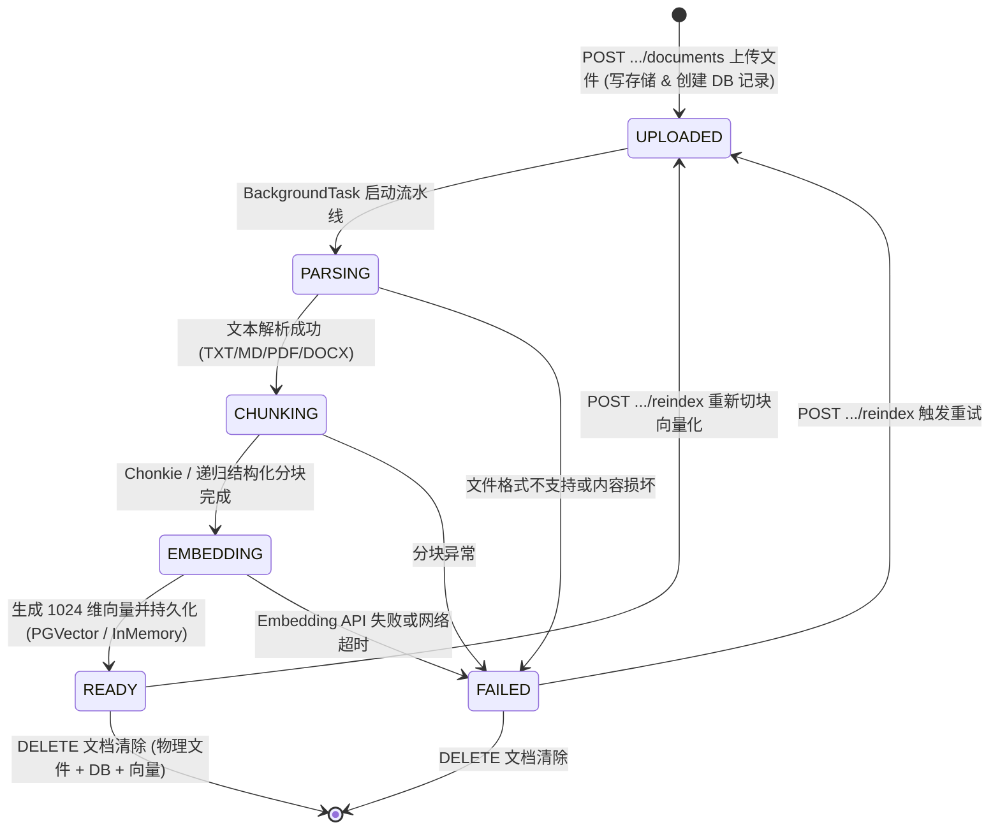
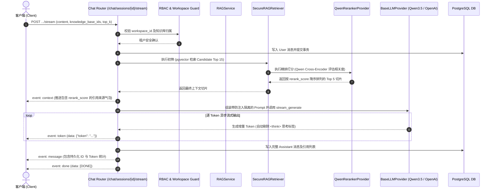
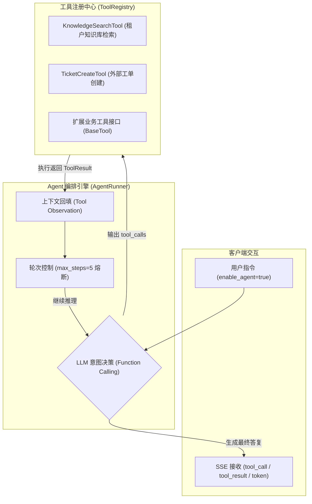
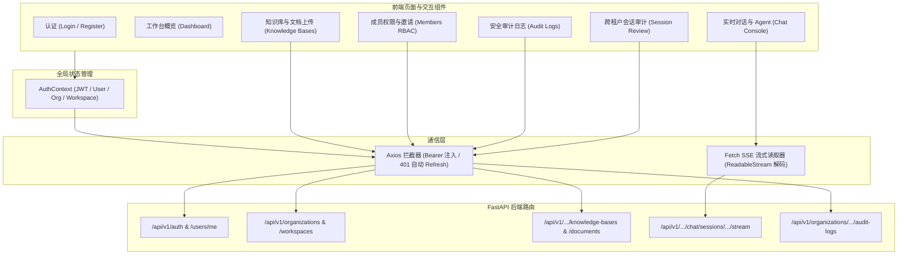

# AI Knowledge Hub 工程设计规范文档 (Engineering Design Document)

> **版本**：v3.0 (两阶段 RAG 与 Chonkie 分块增强基线)  
> **面向对象**：架构师、后端研发、AI 算法工程师、安全审计人员  
> **定位**：企业级多租户 Secure RAG 知识库平台的统一工程设计与数据模型规范。

---

## 1. 总体架构设计 (System Architecture)

AI Knowledge Hub 采用微内核、模块化、高解耦的 FastAPI 异步后端架构，系统划分为三大核心域：
1. **SaaS 多租户与安全鉴权域 (SaaS Core & IAM)**：用户管理、组织隔离、工作区划分、基于角色的权限控制（RBAC）、JWT 状态与 Refresh Token 轮转机制、全生命周期不可篡改审计日志。
2. **知识库与文档处理域 (Knowledge & Ingestion Pipeline)**：多格式解析器（TXT/MD/PDF/DOCX）、Chonkie 结构化智能分块引擎、多源 Embedding 提供者抽象、可插拔对象存储抽象（Local / S3）。
3. **两阶段检索与重排精排域 (Two-Stage Secure RAG & Reranker)**：PostgreSQL 16 + `pgvector`（1024 维 HNSW 索引极速召回）+ Qwen Cross-Encoder 神经重排打分（Top-K 候选集精排），辅以严格的多租户元数据边界过滤机制。

### 1.1 系统架构组件拓扑

```mermaid
flowchart TD
    subgraph ClientLayer ["客户端层 (Client Layer)"]
        WebClient["React SPA Console (Vite + TS + Tailwind)"]
        APIClient["API Consumers / External Services"]
    end

    subgraph APILayer ["API 网关与路由层 (FastAPI Gateway)"]
        RouterAuth["/api/v1/auth (认证 & Token 轮转)"]
        RouterOrg["/api/v1/organizations (组织与成员)"]
        RouterWS["/api/v1/organizations/{org_id}/workspaces (工作区)"]
        RouterKB[".../workspaces/{ws_id}/knowledge-bases (知识库)"]
        RouterDoc[".../knowledge-bases/{kb_id}/documents (文档管道)"]
        RouterChat[".../workspaces/{ws_id}/chat (RAG 会话与流式推送)"]
        RouterAudit["/api/v1/organizations/{org_id}/audit-logs (安全审计)"]
        DepsSecurity["Security & RBAC Guard (require_permission)"]
    end

    subgraph ServiceLayer ["核心业务服务层 (Business Services)"]
        AuthService["AuthService (Argon2 / JWT)"]
        OrgService["Organization & Workspace Service"]
        KBService["KnowledgeBase Service"]
        StorageService["StorageService (LocalStorage / S3 ABC)"]
        PipelineService["DocumentPipelineService (BackgroundTask)"]
        ChunkerEngine["Chunking Factory (ChonkieChunker / RecursiveChunker)"]
        EmbeddingProvider["EmbeddingProvider (Qwen3 1024d / OpenAI / Mock)"]
        VectorStore["VectorStore (PGVectorStore / InMemory)"]
        RerankerProvider["RerankerProvider (QwenReranker Cross-Encoder)"]
        RAGService["RAGService (Two-Stage Retrieval & PromptBuilder)"]
        AgentRunner["AgentRunner (ToolRegistry & ReAct Loop)"]
    end

    subgraph DataLayer ["数据持久化层 (Storage & Database)"]
        PostgresDB[("PostgreSQL 16 (SQLAlchemy 2.x Async)")]
        PGVector[("pgvector 扩展 (vector(1024) HNSW Cosine Index)")]
        LocalStorage[("本地/S3 对象存储 (Tenant-Isolated Raw Files)")]
        LocalModels[("本地模型矩阵 (LM Studio / Ollama: Qwen3.5, Reranker, Embedding)")]
    end

    WebClient & APIClient --> APILayer
    APILayer --> DepsSecurity
    DepsSecurity --> ServiceLayer
    RouterDoc --> PipelineService
    PipelineService --> ChunkerEngine & EmbeddingProvider & VectorStore & StorageService
    RouterChat --> RAGService & AgentRunner
    RAGService --> VectorStore & RerankerProvider & LocalModels
    ServiceLayer --> PostgresDB
    VectorStore --> PGVector
    StorageService --> LocalStorage
```



---

## 2. 数据库实体关系 (Database ER Diagram)

系统遵循严格的多租户级联约束：`Organization -> Workspace -> KnowledgeBase -> Document -> DocumentChunk`。

### 2.1 Mermaid ER 图



### 2.2 核心物理数据表字典

#### 1. `document_chunks` (文档分块与向量)
| 字段名 | 类型 | 约束 | 说明 |
| :--- | :--- | :--- | :--- |
| `id` | `UUID` | PK, 默认 `uuid4` | 分块全局主键 |
| `document_id` | `UUID` | FK -> `documents.id` (CASCADE) | 所属文档 |
| `organization_id` | `UUID` | FK -> `organizations.id` (CASCADE) | 租户过滤加速冗余字段 |
| `workspace_id` | `UUID` | FK -> `workspaces.id` (CASCADE) | 工作区过滤冗余字段 |
| `knowledge_base_id` | `UUID` | FK -> `knowledge_bases.id` (CASCADE) | 知识库过滤冗余字段 |
| `chunk_index` | `INTEGER` | NOT NULL | 块序号，联合唯一 (`document_id`, `chunk_index`) |
| `content` | `TEXT` | NOT NULL | 切块正文文本 |
| `token_count` | `INTEGER` | NOT NULL, default=0 | 该块估算 Token 数 |
| `metadata_json` | `JSON` | NOT NULL, default=`{}` | 块级元数据 (文件名、页码、起止字符偏移等) |
| `embedding` | `vector(1024)` | NULLABLE | pgvector 1024 维向量 (带 HNSW 余弦索引) |

---

## 3. 文档处理管道与分块策略 (Document Pipeline & Chunking Engine)

文档处理通过 FastAPI `BackgroundTasks` 异步驱动，遵循单向确定性状态机。任何异常都会被捕获、安全截断并持久化至 `error_message`，将状态标记为 `FAILED`。

### 3.1 状态机模型



### 3.2 Chonkie 智能结构化分块体系

为了解决传统固定步长切片割裂句子语义与表格语法的问题，系统全面集成 **Chonkie** 分块引擎，支持通过 `CHUNKING_PROVIDER` 与 `CHUNKING_STRATEGY` 动态配置：

1. **策略矩阵**：
   - **`sentence` (默认推荐)**：基于自然语言句子标点（中英文句号、感叹号、问号、分号、换行）划分语义单元，并以重叠窗口贪心聚合，保证句子原子性，有效防止语义在分块边界被截断。
   - **`recursive`**：按照段落大纲层级分隔符（`\n\n` -> `\n` -> 句标点 -> 空格）多级回退切分。
   - **`token`**：基于固定 Token/字符步长与指定 Overlap 滑动切分，适用于代码块或结构均匀的日志文件。
2. **元数据继承机制**：
   - 保留文档页码（`page_number`），多页 PDF 文档分块逐页递增隔离。
   - 记录分块在原文中的精准字符起止偏移 (`start_index`, `end_index`)，便于前端高亮溯源。
   - 统一抽象 `BaseChunker`，保留原有 `RecursiveCharacterChunker` 作为备用 fallback。

---

## 4. 向量存储与多租户检索规范 (Vector Search & Tenant Isolation)

### 4.1 核心接口规范

所有向量存储实现必须继承统一抽象 [`VectorStore`](file:///Users/Yunming.Huang-zd/repos/ai-knowledge-hub/backend/app/services/vector_store/base.py)：
- `upsert(records: list[VectorRecord]) -> None`
- `delete_by_document(document_id: str) -> None`
- `search(query_vector: list[float], filters: dict[str, Any], top_k: int = 5) -> list[SearchResult]`

### 4.2 向量存储实现对比

| 特性 | `PGVectorStore` (生产环境) | `InMemoryVectorStore` (单元测试模式) |
| :--- | :--- | :--- |
| **底层存储** | PostgreSQL 16 + `pgvector` 扩展 | Python 内存字典 (`dict[str, VectorRecord]`) |
| **向量维度** | **1024 维** (标准 Qwen3 Embedding 模型尺寸) | 任意动态维度自适应 |
| **距离计算** | `<=>` (Cosine Distance) + HNSW 索引 | Numpy 矩阵点积余弦相似度 |
| **相似度得分** | `similarity = max(0.0, 1.0 - float(distance))` | `similarity = float(np.dot(q_norm, r_norm))` |
| **并发与持久化** | 强事务 ACID，支持大规模并发与崩溃恢复 | 仅限单元测试秒级断言 |

### 4.3 安全过滤规则 (Secure RAG Hard Boundary)

在执行向量检索时，必须强制附加租户上下文元数据过滤，禁止向检索层暴露跨租户接口：
```sql
SELECT document_chunks.*, 
       (document_chunks.embedding <=> :query_vector) AS distance
FROM document_chunks
WHERE document_chunks.embedding IS NOT NULL
  AND document_chunks.organization_id = :current_organization_id
  AND document_chunks.workspace_id = :current_workspace_id
  AND document_chunks.knowledge_base_id = ANY(:target_knowledge_base_ids)
ORDER BY distance ASC
LIMIT :candidate_top_k;
```

---

## 5. 两阶段检索与重排精排 (Two-Stage RAG & Reranker Engine)

单纯依赖向量余弦相似度的稠密检索（Dense Retrieval）往往无法分辨细微的字面差异、关键词否定或技术接口参数重合。为此，系统采用 **粗排召回 + 神经重排 (Two-Stage Retrieval)** 架构：

```text
[用户提问 Query]
       │
       ▼
[Qwen3 向量模型 (1024 维)] ───► 生成 Query Vector
       │
       ▼
[第一阶段: 粗排初筛 (Candidate Retrieval)]
  - 基于 pgvector HNSW 索引极速召回
  - Candidate Top-K = 15
  - 强制租户隔离过滤 (organization_id, workspace_id, knowledge_base_ids)
       │
       ▼
[第二阶段: 神经精排 (Cross-Encoder Neural Rerank)]
  - Qwen Reranker (qwen3-reranker-0.6b)
  - 拼装 ChatML 意图判断提示词 (Yes / No 归一化评分)
  - 文档前 1000 字符自适应切片与内存溢出防御
       │
       ▼
[最终 Top 5 核心切片] ───► 注入 Prompt 并返回带 rerank_score 引用气泡
```

### 5.1 Reranker 适配器设计 (`QwenRerankerProvider`)
- **标准 API 探测**：优先尝试标准 `/v1/rerank` 或 `/rerank` 端点。
- **Native ChatML Completions 评分兼容**：若宿主服务（如 LM Studio / llama.cpp）未暴露独立 `/v1/rerank`，自动回退到调用 `/v1/completions` 执行 Cross-Encoder 评分，解析 `yes` / `no` 的对数概率与首 Token 倾向，融合向量相似度完成连续打分。
- **稳定性保护**：支持并发信号量控制 (`concurrency=4`) 与文档前置截断防御，避免长文档在显存吃紧时触发 prefill 拒绝。

---

## 6. RBAC 权限矩阵与 API 契约 (API Contracts & Security Matrix)

所有知识库、文档与问答 API 挂载于统一前缀：`/api/v1/organizations/{organization_id}/workspaces/{workspace_id}`。

### 6.1 权限控制矩阵

| 权限代码 (Code) | 描述 | OWNER | ADMIN | EDITOR | VIEWER |
| :--- | :--- | :---: | :---: | :---: | :---: |
| `knowledge:create` | 创建知识库 | ✓ | ✓ | ✓ | - |
| `knowledge:read` | 查询知识库、文档列表/详情、会话历史与流式问答 | ✓ | ✓ | ✓ | ✓ |
| `knowledge:update` | 更新知识库基础信息 | ✓ | ✓ | ✓ | - |
| `knowledge:delete` | 删除知识库（级联清理文件与向量） | ✓ | ✓ | ✓ | - |
| `document:upload` | 上传文档、触发重新索引 (Reindex) | ✓ | ✓ | ✓ | - |
| `document:delete` | 删除文档（清理物理文件与向量） | ✓ | ✓ | ✓ | - |
| `audit:read` | 调阅组织安全审计日志 | ✓ | ✓ | - | - |

---

## 7. Secure RAG 问答与流式会话设计 (Secure RAG & Streaming Chat)

### 7.1 SSE 流式时序流 (Server-Sent Events)



---

## 8. Agent 编排引擎与工具生态 (Agent Orchestration & Tool Ecosystem)

### 8.1 工具调用协议与架构



### 8.2 SSE 工具调用事件流
1. `event: tool_call`: `{"tool_call_id": "...", "name": "...", "arguments": {...}}`
2. `event: tool_result`: `{"tool_call_id": "...", "name": "...", "success": true, "output": "...", "data": {...}}`
3. `event: token`: 模型基于工具执行结果产生的增量文本。
4. `event: message`: 最终落库的 Assistant 消息。
5. `event: done`: `[DONE]` 结束。

---

## 9. 前端架构与交互控制台 (Frontend Console)

前端系统位于 `frontend/`，基于 **Vite + React + TypeScript + Tailwind CSS** 构建，采用纯单页应用 (SPA) 架构，深度集成多租户层级上下文与实时流式推送机制。

### 9.1 架构拓扑与数据流



### 9.2 核心机制设计
1. **多租户上下文自动同步 (`AuthContext`)**：
   - 用户登录后从 `/users/me` 获取用户身份与关联组织列表。
   - 本地持久化保存当前选中的 `organization_id` 与 `workspace_id`。
   - 切换组织时自动级联重载当前组织下的工作区列表，所有页面组件自适应渲染隔离环境下的文档与会话。
2. **双令牌自动静默轮转**：
   - Axios 请求拦截器在所有对外请求头自动挂载 `Authorization: Bearer <access_token>`。
   - 响应拦截器捕获 `401 Unauthorized` 时发起无感知 `POST /api/v1/auth/refresh` 刷新令牌并重试原请求；若刷新失败则重定向至登录页。
3. **原生 SSE 流式读取与状态分发 (`fetchSSE`)**：
   - 避免传统 EventSource 不支持自定义 Authorization Header 的限制，通过底层 `fetch` + `ReadableStream` 流式解码。
   - 实时解析 `context`、`tool_call`、`tool_result`、`token`、`message` 以及 `done` 事件，支撑打字机渲染、引用片段展开（包含 `rerank_score` 相关度标牌）与智能体多步调用徽章。

---

## 10. 附录：独立工程图谱索引

项目内提供独立排版、符合设计系统标准的 HTML 交互图谱，位于 [`docs/diagrams/`](docs/diagrams/)：
1. **[用户认证与 Token 轮转时序图 (`auth-sequence.html`)](docs/diagrams/auth-sequence.html)**
2. **[数据库实体关系与物理模式图 (`database-er.html`)](docs/diagrams/database-er.html)**
3. **[文档处理流水线与状态流转图 (`document-pipeline.html`)](docs/diagrams/document-pipeline.html)**
4. **[Secure RAG 与 Agent 工具执行时序图 (`rag-agent-lifecycle.html`)](docs/diagrams/rag-agent-lifecycle.html)**
