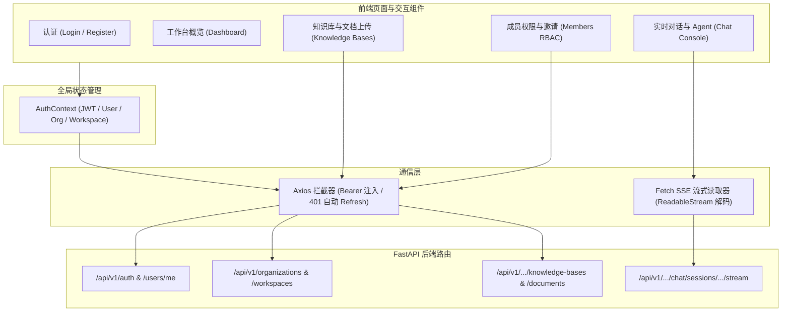

    ObservationNode --> StepCounter
    StepCounter -- "继续推理" --> DecisionNode
    DecisionNode -- "生成最终答复" --> StreamListener
```

### 7.2 SSE 工具调用事件流
1. `event: tool_call`: `{"tool_call_id": "...", "name": "...", "arguments": {...}}`
2. `event: tool_result`: `{"tool_call_id": "...", "name": "...", "success": true, "output": "...", "data": {...}}`
3. `event: token`: 模型基于工具执行结果产生的增量文本。
4. `event: message`: 最终落库的 Assistant 消息。
5. `event: done`: `[DONE]` 结束。

## 8. 前端架构与交互控制台 (Frontend Console)

前端系统位于 `frontend/`，基于 **Vite + React 19 + TypeScript + Tailwind CSS** 构建，采用纯单页应用 (SPA) 架构，深度集成多租户层级上下文与实时流式推送机制。

### 8.1 架构拓扑与数据流


### 8.2 核心机制设计
1. **多租户上下文自动同步 (`AuthContext`)**：
   - 用户登录后从 `/users/me` 获取用户身份与关联组织列表。
   - 本地持久化保存当前选中的 `organization_id` 与 `workspace_id`。
   - 切换组织时自动级联重载当前组织下的工作区列表，所有页面组件自适应渲染隔离环境下的文档与会话。
2. **双令牌自动静默轮转**：
   - Axios 请求拦截器在所有对外请求头自动挂载 `Authorization: Bearer <access_token>`。
   - 响应拦截器捕获 `401 Unauthorized` 时发起无感知 `POST /api/v1/auth/refresh` 刷新令牌并重试原请求；若刷新失败则重定向至登录页。
3. **原生 SSE 流式读取与状态分发 (`fetchSSE`)**：
   - 避免传统 EventSource 不支持自定义 Authorization Header 的限制，通过底层 `fetch` + `ReadableStream` 流式解码。
   - 实时解析 `context`、`tool_call`、`tool_result`、`token`、`message` 以及 `done` 事件，支撑打字机渲染、引用片段展开与智能体多步调用徽章。

## 9. 附录：独立工程图谱索引

项目内提供独立排版、符合设计系统标准的 HTML 交互图谱，位于 [`docs/diagrams/`](docs/diagrams/)：
1. **[用户认证与 Token 轮转时序图 (`auth-sequence.html`)](docs/diagrams/auth-sequence.html)**
2. **[数据库实体关系与物理模式图 (`database-er.html`)](docs/diagrams/database-er.html)**
3. **[文档处理流水线与状态流转图 (`document-pipeline.html`)](docs/diagrams/document-pipeline.html)**
4. **[Secure RAG 与 Agent 工具执行时序图 (`rag-agent-lifecycle.html`)](docs/diagrams/rag-agent-lifecycle.html)**
