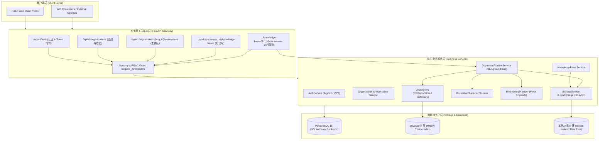
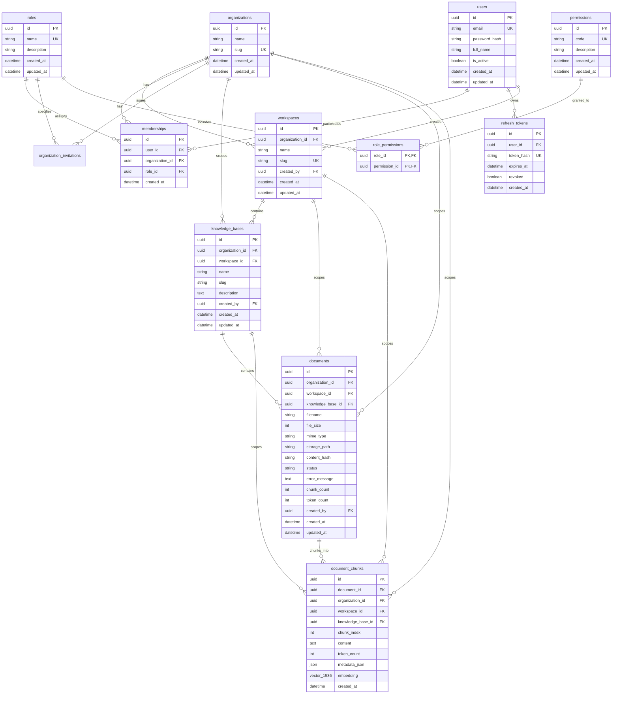
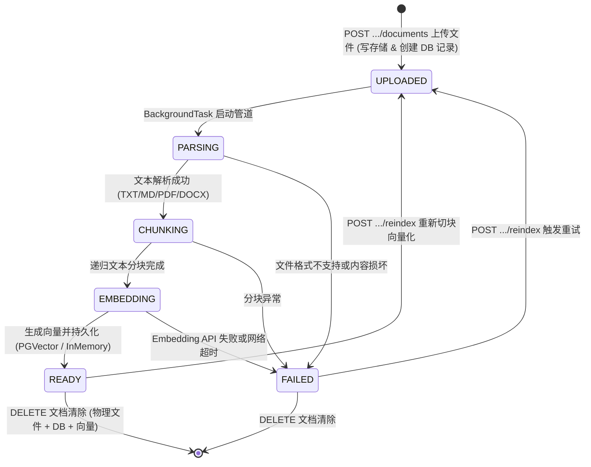

# AI Knowledge Hub 工程设计规范文档 (Engineering Design Document)

> **版本**：v2.0 (Phase 1 & Phase 2 已交付基线)  
> **面向对象**：架构师、后端研发、AI 算法工程师、安全审计人员  
> **定位**：企业级多租户 Secure RAG 知识库平台的统一工程设计与数据模型规范。

---

## 1. 总体架构设计 (System Architecture)

AI Knowledge Hub 采用微内核、模块化、高解耦的 FastAPI 异步后端架构，系统划分为三大核心域：
1. **SaaS 多租户与安全鉴权域 (SaaS Core & IAM)**：用户管理、组织隔离、工作区划分、基于角色的权限控制（RBAC）、JWT 状态与 Refresh Token 轮转机制。
2. **知识库与文档处理域 (Knowledge & Ingestion Pipeline)**：多格式解析器（TXT/MD/PDF/DOCX）、可配置重叠递归分块器、多源 Embedding 提供者抽象、对象存储抽象。
3. **向量引擎与检索域 (Vector Store & Secure RAG)**：PostgreSQL 16 + `pgvector`（含 HNSW 索引）与测试环境内存余弦相似度兼容层、严格的多租户元数据边界过滤机制。

### 1.1 系统架构组件拓扑



---

## 2. 数据库实体关系 (Database ER Diagram)

系统遵循严格的多租户级联约束：`Organization -> Workspace -> KnowledgeBase -> Document -> DocumentChunk`。

### 2.1 Mermaid ER 图



### 2.2 核心物理数据表字典

#### 1. `knowledge_bases` (知识库)
| 字段名 | 类型 | 约束 | 说明 |
| :--- | :--- | :--- | :--- |
| `id` | `UUID` | PK, 默认 `uuid4` | 知识库全局主键 |
| `organization_id` | `UUID` | FK -> `organizations.id` (CASCADE) | 所属组织，禁止跨租户 |
| `workspace_id` | `UUID` | FK -> `workspaces.id` (CASCADE) | 所属工作区 |
| `name` | `VARCHAR(255)` | NOT NULL | 知识库显示名称 |
| `slug` | `VARCHAR(100)` | NOT NULL | 标识符，联合唯一 (`workspace_id`, `slug`) |
| `description` | `TEXT` | NULLABLE | 知识库描述 |
| `created_by` | `UUID` | FK -> `users.id` | 创建者用户 ID |
| `created_at` | `TIMESTAMPTZ` | NOT NULL, UTC | 创建时间戳 |
| `updated_at` | `TIMESTAMPTZ` | NOT NULL, UTC | 更新时间戳 |

#### 2. `documents` (文档)
| 字段名 | 类型 | 约束 | 说明 |
| :--- | :--- | :--- | :--- |
| `id` | `UUID` | PK, 默认 `uuid4` | 文档主键 |
| `organization_id` | `UUID` | FK -> `organizations.id` (CASCADE) | 组织边界约束 |
| `workspace_id` | `UUID` | FK -> `workspaces.id` (CASCADE) | 工作区边界约束 |
| `knowledge_base_id` | `UUID` | FK -> `knowledge_bases.id` (CASCADE) | 所属知识库 |
| `filename` | `VARCHAR(255)` | NOT NULL | 上传原始文件名 |
| `file_size` | `INTEGER` | NOT NULL | 文件大小 (bytes) |
| `mime_type` | `VARCHAR(100)` | NOT NULL | MIME 内容类型 |
| `storage_path` | `VARCHAR(512)` | NOT NULL | 物理存储相对路径 `{org}/{kb}/{doc}/{file}` |
| `content_hash` | `VARCHAR(64)` | NOT NULL | 文件 SHA-256 哈希值 |
| `status` | `VARCHAR(30)` | NOT NULL | 流水线状态 (枚举) |
| `error_message` | `TEXT` | NULLABLE | 处理失败时的错误诊断信息 (最大 500 字符) |
| `chunk_count` | `INTEGER` | NOT NULL, default=0 | 成功切块总数 |
| `token_count` | `INTEGER` | NOT NULL, default=0 | 估算 Token 总量 |
| `created_by` | `UUID` | FK -> `users.id` | 上传人 |

#### 3. `document_chunks` (文档分块与向量)
| 字段名 | 类型 | 约束 | 说明 |
| :--- | :--- | :--- | :--- |
| `id` | `UUID` | PK, 默认 `uuid4` | 分块全局主键 |
| `document_id` | `UUID` | FK -> `documents.id` (CASCADE) | 所属文档 |
| `organization_id` | `UUID` | FK -> `organizations.id` (CASCADE) | 租户过滤加速冗余字段 |
| `workspace_id` | `UUID` | FK -> `workspaces.id` (CASCADE) | 工作区过滤冗余字段 |
| `knowledge_base_id` | `UUID` | FK -> `knowledge_bases.id` (CASCADE) | 知识库过滤冗余字段 |
| `chunk_index` | `INTEGER` | NOT NULL | 块序号，联合唯一 (`document_id`, `chunk_index`) |
| `content` | `TEXT` | NOT NULL | 切块正文文本 |
| `token_count` | `INTEGER` | NOT NULL, default=0 | 该块的 Token 数 |
| `metadata_json` | `JSON` | NOT NULL, default=`{}` | 块级元数据 (文件名、页码等) |
| `embedding` | `vector(1536)` | NULLABLE | pgvector 1536 维向量 (带 HNSW 索引) |

---

## 3. 文档处理管道与状态机 (Document Pipeline Lifecycle)

文档处理通过 FastAPI `BackgroundTasks` 异步驱动，遵循单向确定性状态机。任何异常都会被捕获、安全截断并持久化至 `error_message`，将状态标记为 `FAILED`。

### 3.1 状态机模型



### 3.2 管道处理步骤规格

1. **上传 (Upload)**：
   - 检查文件名非空、内容非空（400 校验）；
   - 生成安全相对路径 `{organization_id}/{knowledge_base_id}/{document_id}/{filename}`；
   - 写入对象存储并计算 SHA-256 哈希；
   - 插入 `documents` 记录，初始状态 `UPLOADED`。
2. **解析 (Parsing)**：
   - 状态更新为 `PARSING` 并提交事务；
   - 根据文件扩展名路由到解析器：
     - `.txt`, `.md`, `.json`, `.csv` -> [`PlainTextParser`](file:///Users/Yunming.Huang-zd/repos/ai-knowledge-hub/backend/app/services/parsers/txt.py)
     - `.pdf` -> [`PDFParser`](file:///Users/Yunming.Huang-zd/repos/ai-knowledge-hub/backend/app/services/parsers/pdf.py) (`pypdf`，自动提取每页文本并记录页码)
     - `.docx` -> [`DocxParser`](file:///Users/Yunming.Huang-zd/repos/ai-knowledge-hub/backend/app/services/parsers/docx.py) (`python-docx`，段落与表格标准化提取)
3. **切块 (Chunking)**：
   - 状态更新为 `CHUNKING`；
   - 使用 [`RecursiveCharacterChunker`](file:///Users/Yunming.Huang-zd/repos/ai-knowledge-hub/backend/app/services/chunking/recursive.py) 进行多级递归切块（默认 `chunk_size=800`, `chunk_overlap=100`, 分隔符 `["\n\n", "\n", "。", ". ", " ", ""]`）；
   - 保留页码及源文件名元数据。
4. **向量化与持久化 (Embedding & Persist)**：
   - 状态更新为 `EMBEDDING`；
   - 调用 [`EmbeddingProvider`](file:///Users/Yunming.Huang-zd/repos/ai-knowledge-hub/backend/app/services/embeddings/base.py) 批量生成向量（OpenAI `text-embedding-3-small` 或确定性 `MockEmbeddingProvider`）；
   - 删除旧分块记录与向量（保证幂等重试安全）；
   - 批量插入 `DocumentChunk`，并将向量插入向量库；
   - 若提取文字为空（如纯图片扫描件 PDF），设置状态为 `READY` 并在 `error_message` 记录提示 `"No extractable text found in document"`；
   - 正常完成更新状态为 `READY`。

---

## 4. 向量存储与多租户检索规范 (Vector Search & Tenant Isolation)

### 4.1 核心接口规范

所有向量存储实现必须继承统一抽象 [`VectorStore`](file:///Users/Yunming.Huang-zd/repos/ai-knowledge-hub/backend/app/services/vector_store/base.py)：
- `upsert(records: list[VectorRecord]) -> None`
- `delete_by_document(document_id: str) -> None`
- `search(query_vector: list[float], filters: dict[str, Any], top_k: int = 5) -> list[SearchResult]`

### 4.2 向量存储实现对比

| 特性 | `PGVectorStore` (生产环境) | `InMemoryVectorStore` (单元测试与无依赖模式) |
| :--- | :--- | :--- |
| **底层存储** | PostgreSQL 16 + `pgvector` 扩展 | Python 内存字典 (`dict[str, VectorRecord]`) |
| **距离计算** | `<=>` (Cosine Distance) + HNSW 索引 | Numpy 矩阵点积余弦相似度 |
| **相似度得分** | `similarity = max(0.0, 1.0 - float(distance))` | `similarity = float(np.dot(q_norm, r_norm))` |
| **生命周期** | 请求/任务事务绑定 (`AsyncSession`) | 运行时单例 (可通过 Fixture 隔离) |
| **并发与持久化** | 强事务 ACID，支持大规模并发与崩溃恢复 | 仅限单元测试秒级断言 |

### 4.3 安全过滤规则 (Secure RAG Hard Boundary)

在执行向量检索时，必须强制附加租户上下文元数据过滤，禁止向检索层暴露跨租户接口：
```sql
SELECT document_chunks.*, 
       (document_chunks.embedding <=> :query_vector) AS distance
FROM document_chunks
WHERE document_chunks.embedding IS NOT NULL
  AND document_chunks.organization_id = :current_organization_id
  AND document_chunks.workspace_id = :current_workspace_id
  AND document_chunks.knowledge_base_id = :target_knowledge_base_id
ORDER BY distance ASC
LIMIT :top_k;
```

---

## 5. RBAC 权限矩阵与 API 契约 (API Contracts & Security Matrix)

所有知识库与文档 API 挂载于统一前缀：`/api/v1/organizations/{organization_id}/workspaces/{workspace_id}`。

### 5.1 权限控制矩阵

| 权限代码 (Code) | 描述 | OWNER | ADMIN | EDITOR | VIEWER |
| :--- | :--- | :---: | :---: | :---: | :---: |
| `knowledge:create` | 创建知识库 | ✓ | ✓ | ✓ | - |
| `knowledge:read` | 查询知识库列表、详情与文档列表/详情 | ✓ | ✓ | ✓ | ✓ |
| `knowledge:update` | 更新知识库名称与描述 | ✓ | ✓ | ✓ | - |
| `knowledge:delete` | 删除知识库（级联清理文件与向量） | ✓ | ✓ | ✓ | - |
| `document:upload` | 上传文档、重新索引 (Reindex) | ✓ | ✓ | ✓ | - |
| `document:delete` | 删除文档（清理物理文件与向量） | ✓ | ✓ | ✓ | - |

### 5.2 端点定义

| Method | Path | 权限要求 | 响应状态 | 说明 |
| :--- | :--- | :--- | :---: | :--- |
| `POST` | `/.../knowledge-bases` | `knowledge:create` | 201 | 创建知识库 |
| `GET` | `/.../knowledge-bases` | `knowledge:read` | 200 | 获取工作区下知识库列表 |
| `GET` | `/.../knowledge-bases/{kb_id}` | `knowledge:read` | 200 | 获取知识库详情 |
| `PATCH`| `/.../knowledge-bases/{kb_id}` | `knowledge:update` | 200 | 更新知识库基础信息 |
| `DELETE`| `/.../knowledge-bases/{kb_id}` | `knowledge:delete` | 204 | 删除知识库并级联清理 |
| `POST` | `/.../knowledge-bases/{kb_id}/documents` | `document:upload` | 201 | 上传文档并提交后台处理 |
| `GET` | `/.../knowledge-bases/{kb_id}/documents` | `knowledge:read` | 200 | 查询知识库下的文档列表 |
| `GET` | `/.../knowledge-bases/{kb_id}/documents/{doc_id}` | `knowledge:read` | 200 | 查询文档状态及切块明细 |
| `POST` | `/.../knowledge-bases/{kb_id}/documents/{doc_id}/reindex` | `document:upload` | 200 | 触发重新索引流水线 |
| `DELETE`| `/.../knowledge-bases/{kb_id}/documents/{doc_id}` | `document:delete` | 204 | 删除文档、存储文件与向量 |

---

## 6. 附录：独立工程图谱索引

项目内提供独立排版、符合设计系统标准的 HTML 交互图谱，位于 [`docs/diagrams/`](docs/diagrams/)：
1. **[用户认证与 Token 轮转时序图 (`auth-sequence.html`)](docs/diagrams/auth-sequence.html)**
2. **[数据库实体关系与物理模式图 (`database-er.html`)](docs/diagrams/database-er.html)**
3. **[文档处理流水线与状态流转图 (`document-pipeline.html`)](docs/diagrams/document-pipeline.html)**
