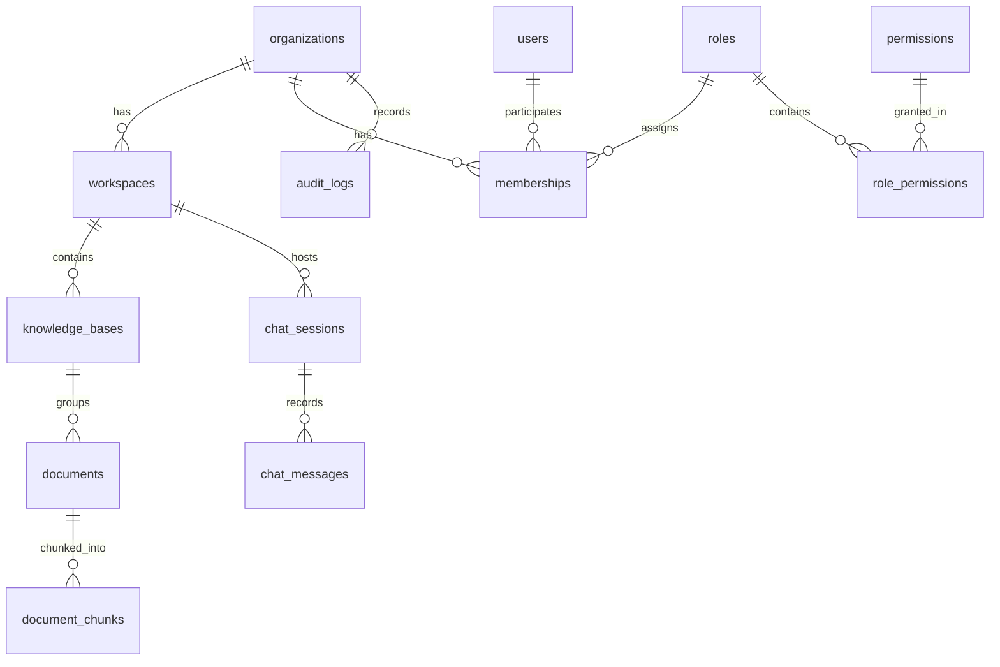
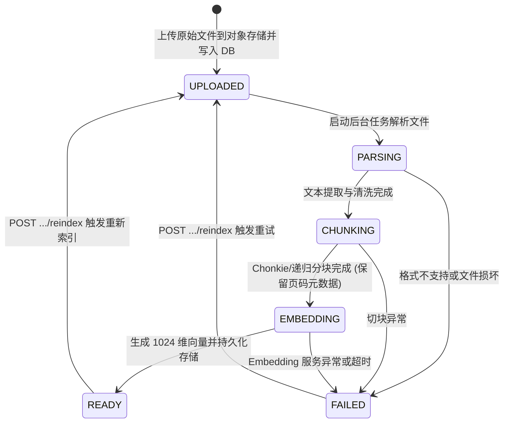

# AI Knowledge Hub 项目知识库

> 面向企业内部团队的多租户 AI 知识库 SaaS。
>
> 当前状态：**全阶段（Phase 1 ~ Phase 6 及两阶段 RAG / Chonkie 扩展）已完整交付并通过 100% 自动化测试（170 项全量 PASS）、PostgreSQL 真实迁移升级与前端静态构建验证**。企业知识库平台全栈闭环就绪。

- **工程设计全景规范**：[docs/ENGINEERING_DESIGN.md](../docs/ENGINEERING_DESIGN.md)
- **Phase 1 执行计划**：[docs/superpowers/plans/2026-08-28-phase-1-python-saas-backend.md](../docs/superpowers/plans/2026-08-28-phase-1-python-saas-backend.md)
- **Phase 2 执行计划**：[docs/superpowers/plans/2026-09-09-phase-2-document-pipeline-vector-store.md](../docs/superpowers/plans/2026-09-09-phase-2-document-pipeline-vector-store.md)
- **Phase 3 执行计划**：[docs/superpowers/plans/2026-09-10-phase-3-secure-rag-retrieval.md](../docs/superpowers/plans/2026-09-10-phase-3-secure-rag-retrieval.md)
- **Phase 4 执行计划**：[docs/superpowers/plans/2026-09-11-phase-4-agent-tools-integration.md](../docs/superpowers/plans/2026-09-11-phase-4-agent-tools-integration.md)
- **Phase 5 执行计划**：[docs/superpowers/plans/2026-09-12-phase-5-react-saas-ui.md](../docs/superpowers/plans/2026-09-12-phase-5-react-saas-ui.md)
- **Phase 6 执行计划**：[docs/superpowers/plans/2026-09-13-phase-6-audit-storage-production.md](../docs/superpowers/plans/2026-09-13-phase-6-audit-storage-production.md)
- **工程设计图谱**：
  - [数据库实体关系与物理模式图 (`database-er.html`)](../docs/diagrams/database-er.html)
  - [文档处理与向量化管道架构图 (`document-pipeline.html`)](../docs/diagrams/document-pipeline.html)
  - [用户认证与 Token 轮转时序图 (`auth-sequence.html`)](../docs/diagrams/auth-sequence.html)
  - [Secure RAG 与 Agent 工具执行时序图 (`rag-agent-lifecycle.html`)](../docs/diagrams/rag-agent-lifecycle.html)

## 1. 项目目标

构建一个支持企业内部团队协作的多租户 AI 知识库平台，覆盖：

- 用户、组织、Workspace 和权限管理
- 文档上传、解析、智能结构化切块 (Chonkie)、向量化与两阶段检索 (PGVector + Reranker)
- 带租户与权限边界隔离的 Secure RAG 问答与多轮上下文对话
- Agent 工具调用与业务系统集成（知识检索、工单创建）
- 现代化企业 SaaS 前端控制台 (Vite + React + TypeScript + Tailwind CSS)
- 安全审计日志轨迹追踪 (Audit Trail Logging)
- 可拔插对象存储适配器 (Local & S3 / MinIO)
- 适配本地与云端模型矩阵（Qwen3 Embedding 1024 维、Qwen3 Reranker、Qwen3.5 LLM）

核心项目特色是 **Secure RAG / Permission-aware RAG**：

> 检索结果必须同时满足租户隔离和资源权限要求，未经授权的内容不能进入 LLM Prompt。

## 2. 总体模块

### 2.1 SaaS 用户与组织体系

核心数据模型：

```text
User
Organization
Membership
Role
Permission
Workspace
KnowledgeBase
Document
DocumentChunk (Vector 1024)
ChatSession
ChatMessage
AuditLog
```

关系层级拓扑：

```text
Organization
├── Memberships (User + Role)
├── AuditLogs (Audit Trail)
└── Workspaces
    ├── Knowledge Bases
    │   └── Documents
    │       └── Document Chunks (pgvector 1024)
    └── Chat Sessions
        └── Chat Messages (Citations & Tokens)
```

#### 数据库实体关系 (ER Diagram)



### 2.2 租户隔离策略

采用 **共享数据库、共享模式、行级租户隔离** 架构：

```text
Shared Database
└── Shared Schema
    └── organization_id + workspace_id / tenant scope
```

所有 API 禁止信任前端传入的 `organization_id`。访问范围必须由后端根据以下链路推导：

```text
JWT
 ↓
User
 ↓
Membership
 ↓
Organization
 ↓
Workspace / Resource
 ↓
Permission
```

任何查询、创建、更新、删除和 AI 检索都必须经过租户上下文和权限校验。

### 2.3 知识库与文档处理

首期已支持格式：

- PDF（`pypdf`，支持保留逐页元数据）
- DOCX（`python-docx`，段落与表格标准化提取）
- Markdown
- TXT / JSON / CSV（`PlainTextParser`）

分块引擎：
- 集成 **Chonkie** 分块框架 (`ChonkieChunker`)，支持：
  - `sentence`：依据句子标点语义边界切分，兼顾长短句自然表达；
  - `recursive`：多级分隔符递归回退分块；
  - `token`：固定 token 窗口分块。
- 完整保留文档页码（`page_number`）与字符起止偏移元数据。

处理流程与状态机：



文档原文件存储于对象存储，不直接存入 PostgreSQL。解析、切块和 Embedding 属于异步任务。

### 2.4 两阶段 RAG 与引用溯源

两阶段检索与安全过滤管线：

```text
User Query
    ↓
Query Rewrite / Clean
    ↓
Embedding (text-embedding-qwen3-embedding-0.6b, 1024 维)
    ↓
Phase 1: Vector Candidate Retrieval (PGVector HNSW, Candidate Top 15)
    ↓
Tenant Filter (workspace_id + organization_id 物理隔离)
    ↓
Document ACL & Knowledge Base Scope Filter
    ↓
Phase 2: Neural Rerank (qwen3-reranker-0.6b Cross-Encoder 语义精排, Final Top 5)
    ↓
Context Assembly (带序号与元数据的防注入 Prompt)
    ↓
LLM Streaming Generation (qwen3.5-4b-mlx / 思考标签清洗)
    ↓
Answer Stream + Citations (含 rerank_score 与页码来源)
```

即使某个未授权文档的相似度很高，也必须在进入 Prompt 前被丢弃。回答实时输出来源文件、页码以及重排相关度分数 `rerank_score`。

### 2.5 Agent 与工具调用

规划核心工具：

```text
search_knowledge_base()
get_user_profile()
create_support_ticket()
```

典型流程：

```text
用户请求
  ↓
Agent 判断任务
  ↓
search_knowledge_base
  ↓
根据结果决定是否需要业务操作
  ↓
create_support_ticket
```

### 2.6 企业安全审计日志 (Audit Logging)

针对关键资源的全生命周期操作统一落盘 `audit_logs` 表：

```text
[HTTP 请求]
     ↓
[AuditMiddleware / AuditService]
     ↓
[异步记录 AuditLog]
  - event_type: login, document.upload, chat.stream, etc.
  - actor_id / actor_email
  - organization_id / workspace_id
  - resource_type / resource_id
  - ip_address / user_agent
  - status: SUCCESS / FAILED
```

- 仅具有 `audit:read` 权限的管理员可通过 `/api/v1/organizations/{id}/audit-logs` 端点调阅。

---

## 3. 推荐的目录规范与工程落地

```text
backend/
├── app/
│   ├── api/routes/          # 路由层：按业务域拆分（auth, organizations, workspaces, knowledge_bases, documents, chat, audit_logs）
│   ├── core/                # 核心配置、安全（Argon2id, JWT）、异常定义
│   ├── db/                  # 数据库连接、AsyncSession 依赖
│   ├── models/              # SQLAlchemy 2.0 ORM 实体（User, Org, Workspace, Document, Chunk, ChatSession, AuditLog）
│   ├── schemas/             # Pydantic v2 请求与响应数据契约
│   └── services/            # 领域业务服务
│       ├── agent/           # AgentRunner, ToolRegistry, BaseTool
│       ├── chunking/        # ChonkieChunker, RecursiveCharacterChunker, BaseChunker 工厂
│       ├── embeddings/      # OpenAI, Mock Embedding 提供者 (1024 维)
│       ├── reranker/        # QwenRerankerProvider, MockRerankerProvider
│       ├── llm/             # OpenAI, Mock LLM 提供者 (含思考标签防溢出)
│       ├── parsers/         # PDF, DOCX, TXT/MD/JSON 解析器
│       ├── pipeline/        # DocumentPipelineService 异步状态机
│       ├── rag/             # SecureRAGRetriever (两阶段检索), PromptBuilder, RAGService
│       ├── storage/         # LocalStorageService, S3StorageService
│       ├── audit.py         # 结构化审计日志服务
│       └── auth.py          # 认证、密码校验与 Token 轮转
├── alembic/                 # 数据库迁移脚本
└── pyproject.toml           # uv 现代化 Python 项目依赖与配置
```

## 4. 安全设计基线

- 绝不信任前端传入的 `organization_id`，所有操作由 JWT -> User -> Membership 严格推导。
- 租户隔离贯穿全文：数据库字段、外键级联、API URL 路径与向量检索元数据过滤。
- 密码存储：强制 Argon2id 哈希，禁止明文或弱散列算法。
- 令牌安全：Access Token 短有效期（默认 30 分钟），Refresh Token 一次性轮转并入库哈希。
- 存储防御：`LocalStorageService` 强制路径穿越防御，原始文件隔离按租户层级存放。
- 审计追溯：敏感事件落盘审计表，仅具备 `audit:read` 权限的管理员可调阅。

## 5. 项目路线图与交付状态

- [x] **第一阶段：Python SaaS 后端基石** (用户、组织、工作区、JWT、RBAC、Compose)
- [x] **第二阶段：文档管道、向量化与向量存储** (解析、切块、OpenAI/Mock Embeddings、PGVector、BackgroundTasks)
- [x] **第三阶段：Secure RAG、检索与问答** (Query 改写、两阶段检索、Qwen Reranker 精排、防注入 Prompt 构造、引用输出、SSE 流式推送)
- [x] **第四阶段：Agent 与工具集成** (Tool Registry、Function Calling 循环驱动、知识库搜索工具、工单集成、SSE 工具流式推流)
- [x] **第五阶段：React SaaS UI** (管理后台、聊天界面、知识库预览、成员权限)
- [x] **第六阶段：企业安全审计加固与生产上线** (审计查询 API 与前端视图、S3/MinIO 存储驱动、全链路回归验证)
- [x] **增强阶段：Chonkie 智能分块与三模型矩阵闭环** (Chonkie 语义切片接入、Qwen3 1024 维向量模型、Qwen3 Reranker、Qwen3.5 4B LLM)

## 6. 已验证实现与运行指令

### 实际工程目录

- `backend/app`：FastAPI 应用、API 路由、Schema、服务、模型、存储、解析器、Chonkie 分块器、Reranker、LLM 及 Agent 运行环境、审计日志服务。
- `backend/alembic`：Alembic 迁移脚本（`0001_initial_schema`, `0002_knowledge_and_documents`, `0003_chat_and_rag`, `0004_audit_logs`）。
- `frontend/`：Vite + React + TypeScript + Tailwind CSS 控制台（仪表盘、知识库、切块预览、SSE 聊天、成员管理、审计日志）。
- `bruno/`：全套 HTTP 接口集合（`00-Health` 至 `09-Audit`）。
- `tests`：租户隔离、RBAC、管道流转、Chonkie 分块、向量库、数据库合约、Secure RAG 检索问答、Rerank 打分、Agent 工具编排、安全审计轨迹与 S3 存储驱动等全套 170 项测试。
- `docs/diagrams`：独立可视化工程图谱（认证时序、数据库 ER、文档管道、RAG & Agent 生命周期）。
- `docs/ENGINEERING_DESIGN.md`：完整工程设计全景文档。
- `compose.yaml`、`Dockerfile`、`.env.example`：本地与容器化运行配置。

### 启动与环境命令

启动后端：
```bash
cp .env.example .env
uv sync
docker compose up -d postgres
uv run alembic upgrade head
uv run uvicorn backend.app.main:app --reload
```

启动前端：
```bash
cd frontend
npm install
npm run dev
# 浏览器访问 http://localhost:5173
```

前端生产打包校验：
```bash
cd frontend
npm run build
```

后端全量自动化测试校验：
```bash
uv run pytest
```
- 全部 170 个测试秒级 PASS (100%)。
